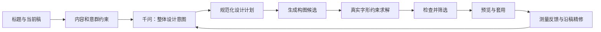

# AI 排版引擎 v6

AI 的输出是一套相互协调的设计意图，编辑器将它编译为真实字体上的构图。右侧参数是实现手段，不再决定生成流程的结构。

## 六个阶段

| 阶段 | 职责 | 结果 |
| --- | --- | --- |
| 内容分析 | 核对原文、意群、焦点；记录用户设计方向与保留选项 | 不可丢字、改字的内容约束 |
| 设计意图 | 千问综合决定字体气质、断行、尺度、阅读轴、占幅、位置、留白和配色 | `typography`、`composition`、`treatment` 及调整理由 |
| 计划规范化 | 校验原文和字体资源，限制不合法或破坏字形的参数，兼容旧响应 | 可以执行的 `DesignPlan` |
| 候选生成 | 保留模型建议，同时在词边界/意群边界搜索替代断行与细微占幅、间距变体 | 每个方向的候选池 |
| 约束求解 | 用真实轮廓计算每行墨迹边界、对齐、行间空间、整组缩放和位置 | 可编辑的页面状态 |
| 筛选与精修 | 检查内容、字形、碰撞、边界、可读字号、尺度关系及意图符合度 | 选中稿、修正记录和下一轮反馈 |

## 模型与本地的分工

千问负责内容判断和整体设计决策。模型不直接写 Canvas/CSS，也不把像素位置当成设计。

本地引擎负责准确测量、候选搜索和约束求解。`constraintFit` 分数仅表示约束符合程度，不代表审美评分。审美取舍仍需围绕模型的设计意图、用户反馈和可见结果判断。

当前内网接口输入是文本。精修发送实际字号比例、行宽、占幅、碰撞、边界、参数和所选计划，不声称模型已经看到渲染图片。

## 设计计划

每个 `designs` 条目包含：

- `name` / `intent`：方向名称与整体设计意图。
- `typography`：已加载的字体、等大或聚焦层级、整体字重。
- `composition`：原文各行、相对字号、对齐轴、标题组占幅与中心、留白节奏、逐行偏移、整体旋转。
- `palette` / `treatment`：配色与背景处理。
- `adjustments`：有限的右侧参数动作，以及动作与整体意图的关系。

模型建议不直接成为最终坐标。求解器会生成候选、实际测量、记录修正，再输出预览状态。

## 字形与内容保护

- AI 默认使用字体原始轮廓。思源黑体、站酷快乐体不再先抽骨架再描粗。
- 无字体的骨架绘制与手动实验风格仍保留在编辑器中；AI 新方案优先使用已加载的完整字体。
- 短标题的尺度关系保持克制；不能通过放大某行、缩小虚词来伪造层级。
- 新设计清理初始示例的日期和装饰，不补写英文副标，不删除用户另行填写的文字。
- 保留原稿模式沿用字体与文字/背景颜色，并保留字形编辑属性；布局仍可重新求解。

## 与旧流程的关系

`AI 按钮 → buildAI → aiLayouts → DESIGN_ENGINE.generate` 是当前主入口。千问响应经 `agApply` 转换为设计计划。

新的 AI 主流程不调用 `AIR / layTune / aiBuild` 预设配方。旧函数为既有模板和调试兼容保留；主流程的字体、间距和尺度由新的编译器求解，避免预设覆盖模型意图。

## 验证边界

本轮验证包含 6 组长短中英文标题、18 套方案和 102 个构图候选，以及内容不被改写、原始轮廓、边界/碰撞、参数同步、保留原稿、撤销和移动端布局。另使用真实千问 v6 响应完成了“宠爱出行”的实际渲染。

这些检查能排除明确的结构故障，不构成“自动生成的每稿都好看”的承诺。真实预览与用户沿稿反馈是下一轮改进的依据。
